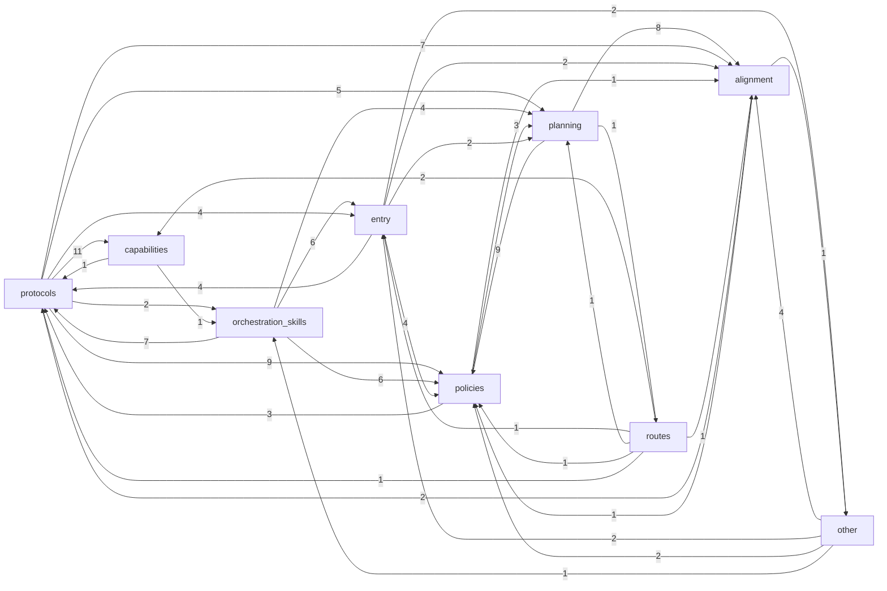

# Cockpit 编排导航图

> 本文件由 `ops/tools/cockpit_map.py` 自动生成，请勿手改。本图定位 Codex 编排治理文件和编排型技能；真实业务目标进入后再建立业务地图。

## 1. 概览

- 编排文件总数：**138**（已排除 state / runs / 业务层 skills）

| 分组 | 文件数 |
| --- | --- |
| alignment | 6 |
| capabilities | 32 |
| entry | 1 |
| orchestration_skills | 39 |
| other | 9 |
| planning | 9 |
| policies | 7 |
| protocols | 11 |
| routes | 24 |

## 2. 分组依赖图

箭头 A --> B 表示 A 分组的文件引用了 B 分组的文件，数字为引用次数。

## 3. 核心真源排名（被引用最多）

被引用越多 = 越是编排骨架，改动影响面越大。

| 入度 | 文件 | 职责 |
| ---: | --- | --- |
| 15 | `ops/agent-prompts/_common.md` | 规定子代理公共执行边界、证据记录和最终回执动作。 |
| 14 | `ops/workflows/alignment/exit.md` | 规定 S4 审查、S2 / S3 修订、S5 出站与 planner seed 生成。 |
| 13 | `AGENTS.md` | 主代理高频工作约定、流程入口、协作与交付边界。 |
| 11 | `ops/protocols/subagent-information-injection.md` | 说明子代理系统身份模板的选择、启动材料渲染和交付形态。 |
| 10 | `ops/policies/state.md` | 规定 `STATUS.md`、`ROADMAP.md`、surface、milestone、任务… |
| 9 | `ops/policies/runtime-tools.md` | 规定运行工具使用、权限与异常恢复边界。 |
| 9 | `ops/policies/test-tooling-governance.md` | 规定测试脚本和验收主体治理。 |
| 9 | `ops/skills/rule-authoring/SKILL.md` | 规定控制面规则的写作原则、不合格判据和变更流程。 |
| 9 | `ops/workflows/planning/validation-dispatch.md` | 规定 P7 Acceptance Contract 编译、Fleet 验收、Reducer 裁决… |
| 8 | `ops/agent-prompts/_review-common.md` | 规定审查能力共用的输入、finding、业务 gate 和输出合同。 |
| 8 | `ops/protocols/task-package-reference/field-dictionary.md` | 解释 task_package 和 FINAL_HANDOFF 字段。 |
| 7 | `ops/workflows/planning/planner-flow.md` | 规定 planning 中 planner 执行编排的生成和修订流程。 |

## 4. 文件职责表

入度表示该文件被当前 map 内已知文件引用的次数；出度表示该文件引用当前 map 内已知文件的次数。

### alignment

| 文件 | 职责 | 入度 | 出度 |
| --- | --- | ---: | ---: |
| `ops/workflows/alignment/WORKFLOW.md` | 规定对齐入口判定、标准规格五步和交付报告。 | 5 | 6 |
| `ops/workflows/alignment/decision-ledger.md` | 规定对齐三道共用的决策分类、记录门槛、呈现与执行期回报。 | 5 | 3 |
| `ops/workflows/alignment/discovery.md` | 规定对齐中的事实侦察、查轮子、成本挑战、实测与子代理报告读法。 | 5 | 0 |
| `ops/workflows/alignment/exit.md` | 规定 S4 审查、S2 / S3 修订、S5 出站与 planner seed 生成。 | 14 | 0 |
| `ops/workflows/alignment/state.md` | 规定对齐状态 v4 的读法、写入入口与写入责任。 | 2 | 2 |
| `ops/workflows/alignment/surfaces.md` | 规定标准规格三个面的锁定对象与完成条件。 | 2 | 4 |

### capabilities

| 文件 | 职责 | 入度 | 出度 |
| --- | --- | ---: | ---: |
| `ops/agent-prompts/CAPABILITIES.md` | 登记子代理能力索引。 | 1 | 25 |
| `ops/agent-prompts/_acceptance-leaf-common.md` | 规定携带 `acceptance_context` 的审查叶子如何逐项执行验收并输出机器结果。 | 2 | 0 |
| `ops/agent-prompts/_common.md` | 规定子代理公共执行边界、证据记录和最终回执动作。 | 15 | 0 |
| `ops/agent-prompts/_review-common.md` | 规定审查能力共用的输入、finding、业务 gate 和输出合同。 | 8 | 1 |
| `ops/agent-prompts/batch-agent/mechanical-batch.md` | 规定 batch-agent / mechanical-batch 能力边界。 | 1 | 0 |
| `ops/agent-prompts/docs-agent/documentation-authoring.md` | 规定 docs-agent / documentation-authoring 能力边界。 | 1 | 0 |
| `ops/agent-prompts/executor-agent/plan-execution.md` | 规定 executor-agent / plan-execution 能力边界。 | 1 | 0 |
| `ops/agent-prompts/executor-agent/scoped-execution.md` | 完成目标和范围明确的实施任务。 | 1 | 0 |
| `ops/agent-prompts/explorer-agent/_explorer-common.md` | 规定探查 / 扫描类能力的公共工作流、证据状态、预算协议和报告结构。 | 2 | 1 |
| `ops/agent-prompts/explorer-agent/codebase-scan.md` | 规定 explorer-agent / codebase-scan 能力边界。 | 1 | 0 |
| `ops/agent-prompts/explorer-agent/network-readiness-scan.md` | 规定 explorer-agent / network-readiness-scan 能力边界。 | 1 | 0 |
| `ops/agent-prompts/explorer-agent/runtime-env-scan.md` | 规定 explorer-agent / runtime-env-scan 能力边界。 | 1 | 0 |
| `ops/agent-prompts/general-agent/general-default.md` | 规定 general-agent / general-default 能力边界。 | 2 | 0 |
| `ops/agent-prompts/plan-checker/plan-review.md` | 规定 plan-checker / plan-review 能力边界。 | 1 | 1 |
| `ops/agent-prompts/plan-checker/proposal-challenge-review.md` | 规定 plan-checker / proposal-challenge-review 能力边界… | 1 | 1 |
| `ops/agent-prompts/plan-checker/requirement-granularity-review.md` | 规定 plan-checker / requirement-granularity-review… | 1 | 1 |
| `ops/agent-prompts/planner-agent/acceptance-authoring.md` | 从已锁定规格独立生成可机械校验的 Acceptance Contract。 | 2 | 0 |
| `ops/agent-prompts/planner-agent/plan-authoring-aggregate.md` | 规定 `planning_pass=aggregate` 的产物结构。 | 0 | 0 |
| `ops/agent-prompts/planner-agent/plan-authoring-slice-detail.md` | 规定 `planning_pass=slice_detail` 的产物结构。 | 0 | 0 |
| `ops/agent-prompts/planner-agent/plan-authoring-topology.md` | 规定 `planning_pass=topology` 的产物结构。 | 0 | 0 |
| `ops/agent-prompts/planner-agent/plan-authoring.md` | 规定 planner-agent / plan-authoring 能力边界。 | 1 | 0 |
| `ops/agent-prompts/research-agent/document-scan.md` | 规定 research-agent / document-scan 能力边界。 | 1 | 0 |
| `ops/agent-prompts/research-agent/external-research.md` | 规定 research-agent / external-research 能力边界。 | 1 | 0 |
| `ops/agent-prompts/research-agent/wheel-discovery.md` | 规定 research-agent / wheel-discovery 能力边界。 | 1 | 0 |
| `ops/agent-prompts/semantic-review-agent/contract-drift-inspection.md` | 审查字段、值域、机制和工具接口在声明侧与消费侧是否一致。 | 1 | 2 |
| `ops/agent-prompts/semantic-review-agent/rule-quality-inspection.md` | 按规则写作门审查控制规则与模型接口文案的执行质量。 | 1 | 3 |
| `ops/agent-prompts/verify-agent/acceptance-synthesis.md` | 按 Acceptance Contract 归并多维验收证据并给出可机械消费的 disposit… | 1 | 0 |
| `ops/agent-prompts/verify-agent/anti-defensive-inspection.md` | 审查代码和文字中的吞错、静默兜底、重复校验、失败软化与拒发必要性。 | 1 | 2 |
| `ops/agent-prompts/verify-agent/code-verification.md` | 判断代码、配置和测试证据是否满足本次任务目标。 | 1 | 0 |
| `ops/agent-prompts/verify-agent/functional-inspection.md` | 验收用户可见功能、数据链路和真实产物是否满足原始目标。 | 1 | 2 |
| `ops/agent-prompts/verify-agent/prompt-bloat-inspection.md` | 审查控制面规则与提示词的膨胀、重复、错层和上下文污染。 | 1 | 2 |
| `ops/agent-prompts/verify-agent/ui-interaction-inspection.md` | 验收真实 UI 入口、用户主路径、状态覆盖和视觉合约。 | 1 | 2 |

### entry

| 文件 | 职责 | 入度 | 出度 |
| --- | --- | ---: | ---: |
| `AGENTS.md` | 主代理高频工作约定、流程入口、协作与交付边界。 | 13 | 18 |

### orchestration_skills

| 文件 | 职责 | 入度 | 出度 |
| --- | --- | ---: | ---: |
| `ops/skills/block-discussion/SKILL.md` | 规定阻塞讨论触发、输入和出路。 | 0 | 3 |
| `ops/skills/block-discussion/references/trigger-cases.md` | 本技能触发的回归基线，竞争性触发验收与漂移修订以此为准。 | 0 | 0 |
| `ops/skills/change-rationale/SKILL.md` | 规定控制面决策记录的留档门槛、记录内容和提交引用。 | 2 | 2 |
| `ops/skills/change-rationale/references/trigger-cases.md` | 本技能触发的回归基线，竞争性触发验收与漂移修订以此为准。 | 0 | 0 |
| `ops/skills/external-review-rescue/SKILL.md` | 把高成本不确定性、外部强模型帮助和深度调研组织成完整任务书、并行投递和可回收结论。 | 1 | 0 |
| `ops/skills/external-review-rescue/references/trigger-cases.md` | 本技能触发的回归基线，竞争性触发验收与漂移修订以此为准。 | 0 | 0 |
| `ops/skills/git-recovery/SKILL.md` | 处理日常 Git 收口失败、回退、revert、分支动作和工作区归属不明变更。 | 0 | 0 |
| `ops/skills/git-recovery/references/trigger-cases.md` | 本技能触发的回归基线，竞争性触发验收与漂移修订以此为准。 | 0 | 0 |
| `ops/skills/pi-rail-dispatch/SKILL.md` | Pi 轨子代理的选型、种子、异步等待与收结果。 | 0 | 0 |
| `ops/skills/pi-rail-dispatch/references/trigger-cases.md` | 本技能触发的回归基线，竞争性触发验收与漂移修订以此为准。 | 0 | 0 |
| `ops/skills/rule-authoring/SKILL.md` | 规定控制面规则的写作原则、不合格判据和变更流程。 | 9 | 7 |
| `ops/skills/rule-authoring/references/agents-authoring.md` | 指导主代理按宿主加载机制创建、审查和精简项目入口。 | 1 | 0 |
| `ops/skills/rule-authoring/references/model-guided-prompting.md` | 将模型官方指南转成适合当前任务与读者的提示改动。 | 1 | 0 |
| `ops/skills/rule-authoring/references/trigger-cases.md` | 模型行为规则与模型接口文案的触发回归基线。 | 0 | 0 |
| `ops/skills/rule-corpus-cleanup/SKILL.md` | 规定代理规则语料去防御清洗流程。 | 1 | 7 |
| `ops/skills/rule-corpus-cleanup/references/acceptance.md` | 规定规则语料清洗验收清单。 | 1 | 0 |
| `ops/skills/rule-corpus-cleanup/references/constitution-template.md` | 规定本语料全部规则文字的写作目标、原则、不合格判据和变更流程。 | 1 | 0 |
| `ops/skills/rule-corpus-cleanup/references/fingerprints.md` | 定义规则语料病灶指纹和审计判据。 | 1 | 1 |
| `ops/skills/rule-corpus-cleanup/references/tasking-templates.md` | 提供规则语料清洗整修和审计任务书模板。 | 1 | 2 |
| `ops/skills/rule-corpus-cleanup/references/trigger-cases.md` | 本技能触发的回归基线，竞争性触发验收与漂移修订以此为准。 | 0 | 1 |
| `ops/skills/skill-authoring-governance/SKILL.md` | 路由技能创建、重写、审查、合并、归档、删除和漂移修订。 | 1 | 0 |
| `ops/skills/skill-authoring-governance/references/skill-authoring-model.md` | 规定技能合同、加载结构、指令粒度和资源分层。 | 2 | 3 |
| `ops/skills/skill-authoring-governance/references/skill-drift-repair.md` | 把声明与行为偏差登记、分诊、回归并修订关闭。 | 0 | 2 |
| `ops/skills/skill-authoring-governance/references/skill-governance-routing.md` | 判断内容归属及新建、修补、合并、归档、删除动作。 | 1 | 1 |
| `ops/skills/skill-authoring-governance/references/skill-quality-gate.md` | 规定技能的增量验证、语义审查与质量结论。 | 2 | 2 |
| `ops/skills/skill-authoring-governance/references/trigger-cases.md` | 供本技能触发与漂移修订回归使用。 | 1 | 1 |
| `ops/skills/subagent-fleet-discipline/SKILL.md` | 教主代理完成多子代理并发作业的放量判定、切片、批量派发、并行推进、收割核验和审计收口。 | 3 | 8 |
| `ops/skills/subagent-fleet-discipline/references/batch-dispatch-playbook.md` | 规定舰队作业从侦察到收割的端到端操作序列与命令形态。 | 3 | 4 |
| `ops/skills/subagent-fleet-discipline/references/fleet-dag-import-test-playbook.md` | 规定有依赖、自动 reducer 或并发节流的舰队如何交给仓内 Fleet Scheduler … | 3 | 3 |
| `ops/skills/subagent-fleet-discipline/references/harvest-and-audit.md` | 规定回执核验步骤、批次回滚、互补审计视角和常见事故对照。 | 3 | 3 |
| `ops/skills/subagent-fleet-discipline/references/parallel-slicing.md` | 把舰队任务从 goal 稳定编译成一组切片（每片一个可独立回答的问题 + read_scope_… | 3 | 4 |
| `ops/skills/subagent-fleet-discipline/references/reducer-wave.md` | 规定 explorer / 审查类切片 ≥3 时的第二波归并节点——输入各片报告路径，并按是否存… | 4 | 3 |
| `ops/skills/subagent-fleet-discipline/references/slice-patterns.md` | 给六类高频舰队任务的标准切片模板——适用判据、切片清单和 reducer 配置，让主代理照模板落… | 1 | 6 |
| `ops/skills/subagent-fleet-discipline/references/trigger-cases.md` | 本技能触发的回归基线，竞争性触发验收与漂移修订以此为准。 | 0 | 0 |
| `ops/skills/tooling-iteration/SKILL.md` | 记录工具使用中的问题，驱动分诊、修复、受影响行为验证和证据关闭。 | 0 | 2 |
| `ops/skills/tooling-iteration/references/trigger-cases.md` | 本技能触发的回归基线，竞争性触发验收与漂移修订以此为准。 | 0 | 0 |
| `ops/skills/writing-governance/SKILL.md` | 把仓内书写任务路由到对应判据，并要求落盘前完成对应自检。 | 0 | 4 |
| `ops/skills/writing-governance/references/document-writing.md` | 规定控制面规则以外的仓内书写（README、PROJECT、handoff、报告、rationa… | 1 | 4 |
| `ops/skills/writing-governance/references/trigger-cases.md` | 写作分流与项目文档写作的触发回归基线。 | 0 | 0 |

### other

| 文件 | 职责 | 入度 | 出度 |
| --- | --- | ---: | ---: |
| `ops/THIRD_PARTY_NOTICES.md` | 记录 Async Subagent 生产 bundle、控制仓 CLI 与构建链的第三方依赖及许… | 0 | 0 |
| `ops/fixtures/acceptance-authoring-route-context.md` | 为 acceptance-authoring route 提供最小、稳定、可复跑的 planne… | 0 | 0 |
| `ops/hooks/prompts/README.md` | 存放 hook 返回给主代理或子代理的可编辑提示文案。 | 0 | 0 |
| `ops/hooks/prompts/main/compact-agents-reminder.md` | 提供压缩恢复后主代理心智锚点卡正文。 | 0 | 1 |
| `ops/hooks/prompts/main/external-truth-reminder.md` | 提供外仓治理文件读取后的真源边界提醒正文。 | 0 | 1 |
| `ops/hooks/prompts/main/post-tool-dispatch-reminder.md` | 提供工具后子代理派发提醒正文。 | 0 | 1 |
| `ops/hooks/prompts/main/stop-state-check.md` | 提供主代理停止前状态自检提醒正文。 | 0 | 2 |
| `ops/workflows/incident-containment.md` | 规定生产事故与阻塞性故障的受控止血通道：准入、止血循环和转正式跟进。 | 1 | 2 |
| `ops/workflows/task-card.md` | 规定任务卡道的卡片结构、一次确认、校验、执行、升级与收口。 | 2 | 5 |

### planning

| 文件 | 职责 | 入度 | 出度 |
| --- | --- | ---: | ---: |
| `ops/workflows/planning/WORKFLOW.md` | 规定已审核规格进入执行编排、派发、验证和收口的主线。 | 3 | 9 |
| `ops/workflows/planning/agent-dispatch.md` | 规定 planning workflow 内部的子代理调度入口。 | 5 | 8 |
| `ops/workflows/planning/execution-gate.md` | 规定 dispatch_manifest 进入 executor 前的编译准入。 | 4 | 4 |
| `ops/workflows/planning/execution-wave.md` | 规定 executor wave 的运行池、join 和失败处理。 | 5 | 2 |
| `ops/workflows/planning/plan-review-flow.md` | 记录 dispatch_manifest 审查从 planning 主线退场后的边界。 | 0 | 0 |
| `ops/workflows/planning/planner-flow.md` | 规定 planning 中 planner 执行编排的生成和修订流程。 | 7 | 10 |
| `ops/workflows/planning/planning-state.md` | 规定 planning 状态字段。 | 4 | 1 |
| `ops/workflows/planning/state-transition.md` | 规定 planning 验收后的状态推进、输出和失败回流。 | 2 | 7 |
| `ops/workflows/planning/validation-dispatch.md` | 规定 P7 Acceptance Contract 编译、Fleet 验收、Reducer 裁决… | 9 | 3 |

### policies

| 文件 | 职责 | 入度 | 出度 |
| --- | --- | ---: | ---: |
| `ops/policies/long-task.md` | 规定长任务推进、阻塞和终止上报。 | 4 | 6 |
| `ops/policies/model-selection.md` | 区分日常选型与角色配置维护，说明配置来源异常的处理入口。 | 1 | 0 |
| `ops/policies/role-fallback.md` | 规定角色回退和 CONTEXT 补齐动作。 | 2 | 1 |
| `ops/policies/runtime-retention.md` | 规定本仓运行态、异步任务和任务定位索引的清理边界。 | 1 | 0 |
| `ops/policies/runtime-tools.md` | 规定运行工具使用、权限与异常恢复边界。 | 9 | 6 |
| `ops/policies/state.md` | 规定 `STATUS.md`、`ROADMAP.md`、surface、milestone、任务… | 10 | 2 |
| `ops/policies/test-tooling-governance.md` | 规定测试脚本和验收主体治理。 | 9 | 2 |

### protocols

| 文件 | 职责 | 入度 | 出度 |
| --- | --- | ---: | ---: |
| `ops/protocols/business-map.md` | 规定业务能力地图的建立、维护和验收。 | 3 | 4 |
| `ops/protocols/cockpit-layering.md` | 规定 `ops/` 内部目录分层和归属。 | 1 | 25 |
| `ops/protocols/file-convention.md` | 规定治理文件引用、文件头和地图 lint 约定。 | 2 | 5 |
| `ops/protocols/granularity-ladder.md` | 定义工作粒度层级词的唯一拼写和状态真源指针；裁决"任务 / 阶段 / 轮"的歧义用词。 | 1 | 6 |
| `ops/protocols/repository-structure.md` | 规定目录归属和新目录准入。 | 5 | 8 |
| `ops/protocols/subagent-capability-prompt-format.md` | 规定子代理能力提示词的分层与章节结构。 | 2 | 5 |
| `ops/protocols/subagent-information-injection.md` | 说明子代理系统身份模板的选择、启动材料渲染和交付形态。 | 11 | 7 |
| `ops/protocols/subagent-material-layering.md` | 定义子代理系统身份、配置注册、角色提示词和任务材料的职责边界。 | 3 | 9 |
| `ops/protocols/task-package-reference/design-guide.md` | 规定任务包和派发规范设计方法。 | 2 | 8 |
| `ops/protocols/task-package-reference/field-dictionary.md` | 解释 task_package 和 FINAL_HANDOFF 字段。 | 8 | 5 |
| `ops/protocols/task-package.md` | 规定任务包协议入口和字段维护归属。 | 3 | 3 |

### routes

| 文件 | 职责 | 入度 | 出度 |
| --- | --- | ---: | ---: |
| `ops/protocols/task-package-routes/batch-agent__mechanical-batch.md` | 规定 batch-agent / mechanical-batch 的专用派发规范。 | 0 | 0 |
| `ops/protocols/task-package-routes/docs-agent__documentation-authoring.md` | 规定 docs-agent / documentation-authoring 的专用派发规范。 | 0 | 0 |
| `ops/protocols/task-package-routes/executor-agent__plan-execution.md` | 规定 executor-agent / plan-execution 的专用派发规范。 | 0 | 0 |
| `ops/protocols/task-package-routes/executor-agent__scoped-execution.md` | 规定 executor-agent / scoped-execution 的专用派发规范。 | 0 | 0 |
| `ops/protocols/task-package-routes/explorer-agent__codebase-scan.md` | 规定 explorer-agent / codebase-scan 的专用派发规范。 | 0 | 0 |
| `ops/protocols/task-package-routes/explorer-agent__network-readiness-scan.md` | 规定 explorer-agent / network-readiness-scan 的专用派发… | 0 | 0 |
| `ops/protocols/task-package-routes/explorer-agent__runtime-env-scan.md` | 规定 explorer-agent / runtime-env-scan 的专用派发规范。 | 0 | 0 |
| `ops/protocols/task-package-routes/general-agent__general-default.md` | 规定 general-agent / general-default 的专用派发规范。 | 0 | 1 |
| `ops/protocols/task-package-routes/plan-checker__plan-review.md` | 规定 plan-checker / plan-review 的专用派发规范。 | 0 | 0 |
| `ops/protocols/task-package-routes/plan-checker__proposal-challenge-review.md` | 规定 plan-checker / proposal-challenge-review 的专用派… | 0 | 0 |
| `ops/protocols/task-package-routes/plan-checker__requirement-granularity-review.md` | 规定 plan-checker / requirement-granularity-review… | 0 | 0 |
| `ops/protocols/task-package-routes/planner-agent__acceptance-authoring.md` | 规定 planner-agent / acceptance-authoring 的专用派发规范。 | 0 | 1 |
| `ops/protocols/task-package-routes/planner-agent__plan-authoring.md` | 规定 planner-agent / plan-authoring 的专用派发规范。 | 1 | 2 |
| `ops/protocols/task-package-routes/research-agent__document-scan.md` | 规定 research-agent / document-scan 的专用派发规范。 | 0 | 0 |
| `ops/protocols/task-package-routes/research-agent__external-research.md` | 规定 research-agent / external-research 的专用派发规范。 | 0 | 0 |
| `ops/protocols/task-package-routes/research-agent__wheel-discovery.md` | 规定 research-agent / wheel-discovery 的专用派发规范。 | 0 | 0 |
| `ops/protocols/task-package-routes/semantic-review-agent__contract-drift-inspection.md` | 规定 semantic-review-agent / contract-drift-inspec… | 0 | 1 |
| `ops/protocols/task-package-routes/semantic-review-agent__rule-quality-inspection.md` | 规定 semantic-review-agent / rule-quality-inspecti… | 0 | 0 |
| `ops/protocols/task-package-routes/verify-agent__acceptance-synthesis.md` | 规定 verify-agent / acceptance-synthesis 的专用派发规范。 | 0 | 0 |
| `ops/protocols/task-package-routes/verify-agent__anti-defensive-inspection.md` | 规定 verify-agent / anti-defensive-inspection 的专用派… | 0 | 1 |
| `ops/protocols/task-package-routes/verify-agent__code-verification.md` | 规定 verify-agent / code-verification 的专用派发规范。 | 0 | 0 |
| `ops/protocols/task-package-routes/verify-agent__functional-inspection.md` | 规定 verify-agent / functional-inspection 的专用派发规范。 | 0 | 0 |
| `ops/protocols/task-package-routes/verify-agent__prompt-bloat-inspection.md` | 规定 verify-agent / prompt-bloat-inspection 的专用派发规… | 0 | 1 |
| `ops/protocols/task-package-routes/verify-agent__ui-interaction-inspection.md` | 规定 verify-agent / ui-interaction-inspection 的专用派… | 0 | 0 |

## 5. 外部真源

- 字段枚举和值域见 `ops/protocols/task-package-reference/field-dictionary.md`。
- `ops/` 内部分层见 `ops/protocols/cockpit-layering.md`。
- 技能归属以 `SKILL.md` frontmatter 的 `layer`、`domain` 和 `capability_group` 字段为准；编排型技能进入本图。
- 当前状态见 `STATUS.md`；当前路线见 `ROADMAP.md`。
